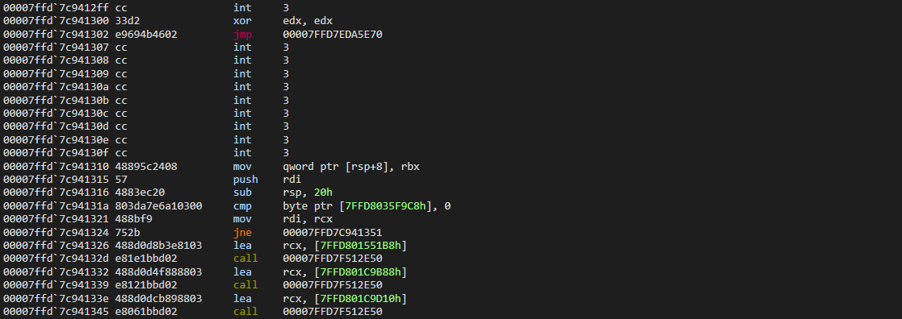
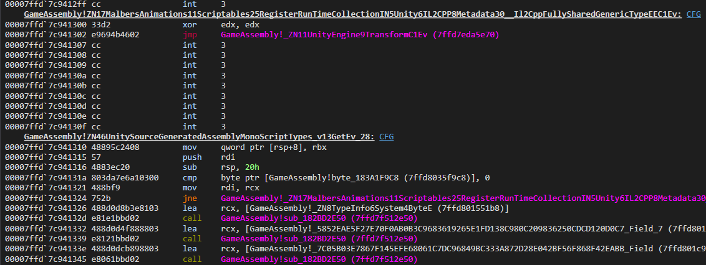
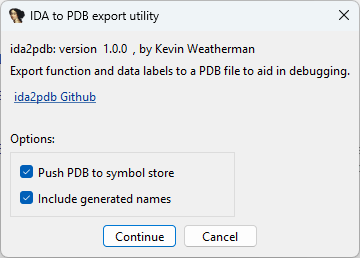

## "IDA to PDB" is an IDA Pro binary plugin that generates a PDB file from the function and data names for symbols in a debugger.

### Before, just addresses



### After, now with PDB symbols!



Within IDA there are limited choices to see your names/label symbols in a debugger. Yes if using IDA itself as a debugger, but not if you are using [x64dbg](https://x64dbg.com/#start), [WinDbg](https://learn.microsoft.com/en-us/windows-hardware/drivers/debugger/), etc. There are options like using a two step process to export, then input into a debugger with specific scripts, but a PDB file from this plugin is a one step process. ida2pdb creates a PDB that is automatic loading and universal for Windows debuggers.

## Installation

Two options

1) Using the IDA plugin manager: `hcli plugin install ida2pdb`  
   Which has the advantage of making plugins easier to update.   
   See [Introducing the IDA Plugin Manager](https://hex-rays.com/blog/introducing-the-ida-plugin-manager) on how to install the `hcli` tool et al.
2) Or just copy `ida2pdb.dll` to `%APPDATA%\Hex-Rays\IDA Pro\plugins`  
<a href="https://github.com/kweatherman/ida2pdb/releases/latest"></a>

The plugin has no default hotkey, edit your `%APPDATA%\Hex-Rays\IDA Pro\plugins\plugins.cfg` to add one.

## Using

Invoke the plugin via the hotkey you set or via IDA's Edit->Plugin (look for "IDA to PDB export utility") menu.  

#### The main dialog



#### Options

* **Push PDB to symbol store.** Exports PDB that's pushed into the local symbol store automatically. Checked by default. The typical usage pattern is to have debuggers load the PDB automatically for the matching executable. If unchecked, the plugin will ask for a destination path to save to instead.  
  
  The symbol store location is determined by documented Microsoft tools behavior. It looks for environment variables like `_NT_SYMBOL_PATH` , etc., and if nonexistent a `C:\ProgramData\Dbg\sym` destination path is used by default.  
  Overwrites an existing PDB that has the exact same GUID path and filename.
* **Include generated names.** Include all names/labels with an address, such as `sub_401000` and `loc_401000`, etc.; names that have IDA `has_dummy_name()` flags set. Checked by default as its generally more useful to have a lot of names to stay in sync while looking at function branch labels, generic data labels, etc. Uncheck it if you want a smaller generated PDB or if the increased names are more noise than useful to you.

#### Need for the original executables

The plugin looks at the current IDB to gather PDB details from the [CodeView](https://isc.sans.edu/diary/PE+files+and+debug+info/22982) entry: GUID, age, and path. If any of that is missing it will look for the source executable in the same folder  (I.E. a "GameAssembly.dll" for a "GameAssembly.dll.i64" you have loaded) for the data it needs. If it can't find it there, it will prompt you for the file.

#### Refreshing debugger PDB

While working in a WinDbg debugging session and you generate an updated PDB using ida2pd while in IDA, do a `.reload /f <module_name>` in the debugger to tell it to reload the changed PDB. If you are having issues, try adding the `/i` switch which directs it to "ignore mismatches".  
For x64dbg a `symdownload <module_name>` should work. Otherwise might take an explicit  `symload <module_name>, C:\path\to\myapp.pdb, 1`, and maybe first preceded by a `symunload <module_name>` too.

### Headless 

The plugin was built for both GUI and headless running.  
Example command line: 
`idat.exe -A -Lexport.log -Sexport_ida2pdb.py database.i64`

Where an "export_ida2pdb.py" script could be as simple as:
```python
import ida_auto
import idaapi

ida_auto.auto_wait()
idaapi.load_and_run_plugin("ida2pdb", 0)
idaapi.qexit(0)
```

The [load_and_run_plugin()](https://python.docs.hex-rays.com/ida_loader/index.html) argument ('0' in the example) is setup as a series of bit flags

#### Optional controlling argument bit flags

| Bit | Effect |
|---|---|
| `0x01` | Publish the finished PDB into the local symbol store. Same as **Push PDB to symbol store** checked in the GUI version. |
| `0x02` | Include generated address names. Same as **Include generated names** checked in the GUI version. |
| `0x04` | Write the full name list to a text file. For internal developer/AI agent use. |
| `0x08` | Stop after names are accepted and before the PDB file is committed. For internal developer/AI agent use. |

For example, `0x03` selects both normal GUI-equivalent options.  
Auto-analysis must already be finished. If it is not, the headless run writes the identity report with `ok=no` and does not export.

## Motivation

I generally don't like using IDA's built in debugger options, I prefer using x64dbg and WinDbg. In particular when I want to use [TTD](https://learn.microsoft.com/en-us/windows-hardware/drivers/debuggercmds/time-travel-debugging-overview), I'll use WinDbgX. Although support was added to IDA ([announcement page](https://docs.hex-rays.com/core/debugger/concepts/local-debugging/windbg-ttd)) for at least some TTD functionality..

There does exist some IDA symbol and import export options like my very own [IDA x64dbgExport](https://github.com/kweatherman/ida_x64dbgexport_plugin), based on the Python script one in the official x64dbg repo (and one I haven't updated in long time), but less than ideal and that particular one is x64dbg only (not for WinDbg et al). Also Microsoft added some strange unconventional way for adding symbols to WinDbgX that no one really uses. The better solution is a PDB for our executables. Since we don't have one, we can generate one from just the names/labels that we add and those that are autogenerated, those that come from AI queries, etc., from within IDA.

I found the [FakePDB](https://github.com/mixaill/fakepdb) repo which at first looked like it would fit the bill, but it has some major issues like the ones I posted in [issue #37](https://github.com/Mixaill/FakePDB/issues/37), back in 2023. Plus it didn't push to the symbol store automatically like I wanted. I did fix that by adding to the plugin script a call out to "symstore.exe", but still far from ideal.

I've been meaning to come back to this for a while to make my own preferred/better solution and AI coding agents has made it all that easier to do. Thus "ida to pdb" was born.

### ida2pdd vs FakePDB

* All-in-one single IDA binary plugin vs FakePDB's Python scripts that call out to another stand alone executable to process a JSON DB and write a PDB out. Some pros to that setup though, such as the Python route tends to make supporting older IDA versions easier. I only officially support the latest IDA version.
* ida2pdb optionally pushes the generated PDB to the local symbol store automatically. And is not dependent on `symstore.exe` nor needing `dbghelp.dll`, etc., to be in the local search path.
* ida2pdb only generates a PDB file. No LIB or JSON DB file export options like FakePDB has. There is no immediate need for those format and have yet to find reason to add them.
* ida2pdb has no "Binary signature search" utility feature. Instead use my [SigMakerEx](https://github.com/kweatherman/sigmakerex) or similar signature generator plugin and use IDA's "Search for sequence of bytes" (default ALT-B hotkey) to do such searches.
* ida2pdb is significantly faster than FakePDB. I.E. It only took ida2pdb 4.5 seconds to push a PDB that generated from a huge 1.5 million names IDB.
* ida2pdb has full headless support built-in.

## Building

Built using Visual Studio 2026, in Windows 11. Uses a minimal LLVM library build dependency for PDB file writing.  
Use the `all-in-one-local-llvm.ps1` to fist download to a local root project "llvm" folder w/`-Download`, then again w/`-Build` to have VS2026 build the LLVM PDB libs in a DLL CRT configuration with minimal dependencies. The fully built LLVM folder will be huge at over 4GB in file size, but one can use an AI prompts (feeding it the project file, file tree, etc.) to run an agent editor, or built up script to reduce that size down to around a more manageable ~128MB.  

Additionally requires my [IDA Pro Plugin Support Libraries](https://github.com/kweatherman/IDA_Support).

Use the `publish.ps1` script to package and optionally build a release.

## Design and Engineering notes

* Uses LLVM `llvm::pdb::PDBFileBuilder` class facility (as most devs use) to write a PDB format file out. A much better alternative vs trying to use Microsoft's internal PDB services (with wacky COM) that has no maintained public documentation.

* AI assisted using ChatGPT for initial research, then guidance, and rules and other AI workflow docs. [Cursor](https://cursor.com) as the AI agent editor. Using a combination of Grok 4.7 and other frontier models for coding, review, and testing.

* Manually gathered a corpus of several EXE and DLLs with existing PDBs and some IDB sources without companion executables to do extensive verification steps with AI assistance to ensure the generated PDB output is solid. Did stand alone LLVM writer smoke test, structural inspection using `llvm-pdbutil`, symbol-by-symbol comparison of generated vs source PDBs, debugger consumption tests through CDB,x32dbg, and x64dbg,, and several more. This doesn't mean it's guaranteed to be 100% bug free of course. Use the repo [issues](https://github.com/kweatherman/ida2pdb/issues) feature to report bugs et al.

*  Not exporting types to PDB currently as:

  1) There is usually no types to export from majority of people adding names, etc., to their IDBs.
  2) The edge cases where their is metadata to create them automatically such as with IL2CPP exporting tools w/IDA import scripts, the types are mostly just pseudo-types. The types might be in IDA type views, but can't be cast to a pointer type in debuggers anyhow as that takes real byte by byte representations. And while FakePDB does export some type info to it's JSON output file, it doesn't actually write them to it's generated PDB.

     Although there are some PDB exporters (like [SourceSync](https://github.com/Air14/SourceSync)) that do. If I find a compelling use case I might add it and/or others are welcomed to add this as a feature to ida2pdb for a merge request.     
  
* The order at which the symbol store path resolver works (based on MS documentation on how `symstore.exe` works):

  1) The first eligible directory in `_NT_SYMBOL_PATH`.
  2) "" `_NT_ALT_SYMBOL_PATH`.
  3) "" `_NT_ALTERNATE_SYMBOL_PATH`.
  4) `<DBGHELP_HOMEDIR>\sym` when that variable is a local path.
  5) Else defaults to `C:\ProgramData\Dbg\sym`.

* When the **Push PDB to symbol store** option is checked, the PDB is exported to a temp file first and then only on success (which should be like 99.99% of the time) the PDB gets written into the symbol store.

* PDB file storage path layout (MS standard) is:  
  `<store>\<expected PDB basename>\<GUID and age>\<expected PDB basename>`  
  The key is the uppercase Windows GUID field order followed by the age in unpadded hexadecimal. Age 27 uses the suffix `1B`. After a successful publish, `pingme.txt` is created in the store root when it is absent. An existing marker is left unchanged.
  Of which the actual path you can see in the plugin log window output I.E. `"C:\ProgramData\Dbg\sym\GameAssembly.pdb\F25F67E081F140D883AA73668246E9BE8\GameAssembly.pdb"`

* There are a number of developer, AI agent helper, text files for input and output that users don't need, probably don't even want to know about. The exported ones using headless mode flags. Files like "patch-basename.txt", "patch-signature.txt", "ida2pdb-arg.txt", etc. Can be found by searching the code for ".txt". Or just have AI agents find them and explain what they do if you're interested.

* Currently just x86 and AMD64 PE are support targets. ARM PE has not been tested.

## Credits

Thanks to Mikhail Paulyshka and his [FakePDB](https://github.com/mixaill/fakepdb) for AFAIK the first of it's kind of an IDA PDB exporter.

----

## Licenses

**1) MIT License**

MIT License: applies to the original ida2pdb project code and documentation.  
Copyright © 2026–present Kevin Weatherman  

Permission is hereby granted, free of charge, to any person obtaining a copy of this software and associated documentation files (the "Software"), to deal in the Software without restriction, including without limitation the rights to use, copy, modify, merge, publish, distribute, sublicense, and/or sell copies of the Software, and to permit persons to whom the Software is furnished to do so, subject to the following conditions:

The above copyright notice and this permission notice shall be included in all copies or substantial portions of the Software.

See [MIT License](http://www.opensource.org/licenses/mit-license.php) or "LICENSES.txt" MIT section for full details.

**2) LLVM License**

The LLVM Project is under the Apache License v2.0 with LLVM Exceptions.  
 Apache License,  Version 2.0, January 2004, http://www.apache.org/licenses/

See "LICENSES.txt" LLVM section for full details.

THE SOFTWARE IS PROVIDED "AS IS", WITHOUT WARRANTY OF ANY KIND, EXPRESS OR
IMPLIED, INCLUDING BUT NOT LIMITED TO THE WARRANTIES OF MERCHANTABILITY, FITNESS
FOR A PARTICULAR PURPOSE AND NONINFRINGEMENT.  IN NO EVENT SHALL THE
CONTRIBUTORS OR COPYRIGHT HOLDERS BE LIABLE FOR ANY CLAIM, DAMAGES OR OTHER
LIABILITY, WHETHER IN AN ACTION OF CONTRACT, TORT OR OTHERWISE, ARISING FROM,
OUT OF OR IN CONNECTION WITH THE SOFTWARE OR THE USE OR OTHER DEALINGS WITH THE
SOFTWARE.
